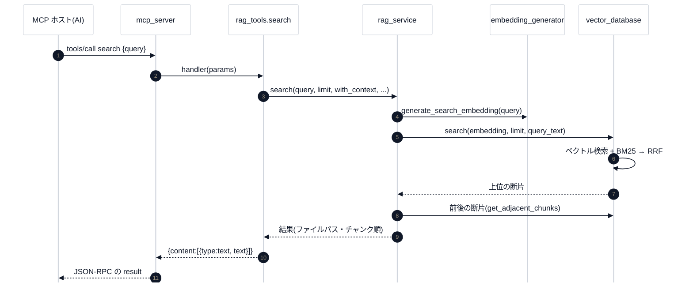

# 1. 全体像

## 1.1 一言で

あなたの文書(Markdown・テキスト・PDF・Word・PowerPoint)を索引にして、**AI アプリ(Claude Desktop など)が、質問のたびに関連する断片を検索できる**ようにする、ローカルの MCP サーバー。
すべてこの PC の中で動く(データを外へ送らない)。[karaage0703/mcp-rag-server](https://github.com/karaage0703/mcp-rag-server) のフォークで、**ChromaDB**(Docker・PostgreSQL 不要)・**Windows ネイティブ**・**Obsidian vault**・**日本語の語の検索(BM25 + Sudachi)**に向けた改変が入っている。

## 1.2 2 つの局面

### 索引を作る(事前)

```mermaid
%%{init: {"theme":"base","fontFamily":"Noto Sans JP, Hiragino Sans, Meiryo, sans-serif","themeVariables":{"fontFamily":"Noto Sans JP, Hiragino Sans, Meiryo, sans-serif","primaryColor":"#ffffff","primaryBorderColor":"#d0d5dd","primaryTextColor":"#101828","lineColor":"#667085","clusterBkg":"#f2f4f7","clusterBorder":"#d0d5dd","edgeLabelBackground":"#ffffff"},"flowchart":{"wrappingWidth":480,"nodeSpacing":40,"rankSpacing":56,"padding":14},"sequence":{"mirrorActors":false,"wrap":false,"width":150,"actorMargin":30,"messageMargin":34}}}%%
flowchart LR
    A["SOURCE_DIR の文書"]:::input --> B["markitdown で<br/>Markdown に変換"]:::input --> C["チャンクに分割<br/>(500 字・重なり 100 字)"]:::proc --> D["ベクトル化<br/>(multilingual-e5-large)"]:::proc --> E["ChromaDB に保存<br/>+ BM25 の索引"]:::out
    classDef input fill:#dae8fc,stroke:#1a73e8,color:#101828
    classDef proc fill:#e6f4f1,stroke:#0f9d8a,color:#101828
    classDef out fill:#fff7ed,stroke:#e8710a,color:#101828
```

### 検索する(質問のたび)

## 1.3 主な決まり

| 決まり | 内容 |
|---|---|
| **namespace** | `SOURCE_DIR` の最初の階層のフォルダ名 = ChromaDB のコレクション名。`_`・`.` で始まるフォルダは対象外。直下のファイルは `default` |
| **差分インデックス** | ファイルのハッシュ・更新日時・サイズのどれかが、記録(`processed/file_registry.json`)と違えば再処理 |
| **ハイブリッド検索** | ベクトル(意味)+ BM25(語)を RRF(順位の融合)で合わせる |
| **前後の文脈** | 既定で、見つけた断片の前後 1 つずつも返す(`with_context`) |
| **接頭辞** | e5 系は、質問(`query:`)と文書(`passage:`)で使い分ける(`.env`) |
| **標準出力はプロトコル専用** | ログは stderr とファイル。Windows では UTF-8 に包み直す |

## 1.4 設定(`.env`)

| 変数 | 意味 | 既定 |
|---|---|---|
| `SOURCE_DIR` / `PROCESSED_DIR` | 原本 / 変換済みの置き場 | `data/source` / `data/processed` |
| `CHROMA_PATH` | ChromaDB の保存先 | `./data/chroma` |
| `EMBEDDING_MODEL` | 埋め込みモデル | `intfloat/multilingual-e5-large` |
| `EMBEDDING_DIM` | ベクトルの次元 | `1024`(モデルに合わせる) |
| `EMBEDDING_PREFIX_QUERY` / `..._EMBEDDING` | 質問 / 文書の接頭辞 | 空 |

`.env` には秘密情報が入りうるので、**git に入れない**(`.gitignore` 済み)。

## 1.5 方針と限界

- **データは外へ送らない**: 埋め込みも検索も、この PC の中。
- **精度を測る仕組みは、まだ無い**: 検索の改良は、評価セットを作って測ってから([講義 第 7 回](../lecture/07-testing-capstone.md))。
- **既知の食い違い**が、いくつかある(`CLAUDE.md` が PostgreSQL 版のまま・`archived` が効かない・固定パスなど)。[トラブルシュートとメンテナンス](06-troubleshooting-maintenance.md) に一覧。

次は [2. コードの読み方](02-code-tour.md)。
