# 2. コードの読み方

## 2.1 読む順番

**入口 → 道具 → 検索 → 索引**。迷ったら、`rag_service.search` から読む。

```mermaid
%%{init: {"theme":"base","fontFamily":"Noto Sans JP, Hiragino Sans, Meiryo, sans-serif","themeVariables":{"fontFamily":"Noto Sans JP, Hiragino Sans, Meiryo, sans-serif","primaryColor":"#ffffff","primaryBorderColor":"#d0d5dd","primaryTextColor":"#101828","lineColor":"#667085","clusterBkg":"#f2f4f7","clusterBorder":"#d0d5dd","edgeLabelBackground":"#ffffff"},"flowchart":{"wrappingWidth":480,"nodeSpacing":40,"rankSpacing":56,"padding":14},"sequence":{"mirrorActors":false,"wrap":false,"width":150,"actorMargin":30,"messageMargin":34}}}%%
flowchart LR
    A["main.py<br/>入口"]:::input --> B["mcp_server.py<br/>JSON-RPC"]:::input --> C["rag_tools.py<br/>道具"]:::proc --> D["rag_service.py<br/>統括"]:::proc --> E["vector_database.py<br/>検索の核"]:::out --> F["document_processor.py<br/>embedding_generator.py"]:::stop
    classDef input fill:#dae8fc,stroke:#1a73e8,color:#101828
    classDef proc fill:#e6f4f1,stroke:#0f9d8a,color:#101828
    classDef out fill:#fff7ed,stroke:#e8710a,color:#101828
    classDef stop fill:#fef3f2,stroke:#d92d20,color:#101828
```

## 2.2 ファイルの役割

| ファイル | 行 | 役割 | 副作用 |
|---|---:|---|---|
| `src/main.py` | 96 | 標準入出力の UTF-8 化・ログ・サービスの組み立て・起動 | stdin / stdout / ログファイル |
| `src/mcp_server.py` | 333 | JSON-RPC over stdio。道具の登録・`initialize`・`tools/list`・`tools/call` | stdin / stdout |
| `src/rag_tools.py` | 279 | 道具 `search`・`get_document_count`。環境変数から `RAGService` を作る | — |
| `src/rag_service.py` | 345 | 索引(`index_documents`)・検索(`search`)・クリア・件数 | DB |
| `src/vector_database.py` | 519 | ChromaDB・BM25・RRF・トークン化(Sudachi)・前後の断片 | `data/chroma/`(Chroma・BM25 の pickle) |
| `src/document_processor.py` | 387 | 読み込み・markitdown 変換・**チャンク分割**・ハッシュ・レジストリ | `data/processed/` |
| `src/embedding_generator.py` | 143 | sentence-transformers・接頭辞 | モデルの読み込み(重い) |
| `src/cli.py` | 326 | `index`・`clear`・`count` | DB・ファイル |
| `auto_index.py` | 271 | vault の監視・`expires` の更新・ダッシュボード | 文書の書き換え・子プロセス |

### 迷わないための目印

- 「**検索の順序**」→ `VectorDatabase.search`(ベクトル → BM25 → RRF)。
- 「**どこで文脈を足す**」→ `RAGService.search`(`with_context`・`full_document`)。
- 「**結果の文面**」→ `rag_tools.search_handler`(ファイルごとにまとめる)。
- 「**環境変数の読み取り**」→ `rag_tools.create_rag_service_from_env`(PostgreSQL 時代の名残も、ここにある)。

## 2.3 検索結果のデータの形

各層の間で、断片は **辞書**で受け渡されます。

| キー | 意味 |
|---|---|
| `document_id` | `<処理済みファイル名>_<チャンク番号>` |
| `content` | 断片の本文 |
| `file_path` | 処理済み(Markdown)のファイルのパス |
| `chunk_index` | ファイルの中での順番(前後の文脈に使う) |
| `similarity` | ベクトル検索: コサイン類似度 / BM25: BM25 の点 / **RRF のあと: RRF の点** |
| `metadata` | `file_name`・`directory` など |
| `namespace` | コレクション名 |
| `is_context` / `is_full_document` | 前後の文脈・全文から足したものの印。**`rag_tools` は読むが、`vector_database` は付けない**(既知の問題。[06](06-troubleshooting-maintenance.md)) |

## 2.4 テスト

| 見たいもの | ファイル |
|---|---|
| MCP サーバー | `tests/test_mcp_server.py` |
| 埋め込みの接頭辞 | `tests/test_embedding_generator.py` |
| 検索の核(チャンク・RRF・トークン・namespace) | `tests/test_search_core.py` |
| 古いテスト(失敗する) | `tests/test_vector_database.py` |
| 文書 | `tests/test_docs.py` |

次は [3. 内側の仕組み](03-internals.md)。
