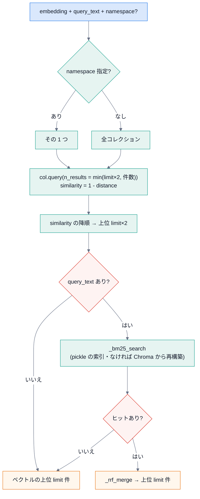

# 3. 内側の仕組み

## 3.1 検索の内側(`VectorDatabase.search`)

- **コレクション**は namespace ごと。全部を横断するときは `client.list_collections()`。
- ChromaDB の距離は、コサイン(`hnsw:space: cosine`)。`similarity = 1.0 - distance`。
- BM25 の点は、`similarity` に**そのまま入る**(単位が違う)ので、**RRF で順位だけを使って合わせる**。

## 3.2 BM25 の索引

| 項目 | 内容 |
|---|---|
| 保存先 | `{CHROMA_PATH}/bm25/{namespace}.pkl`(pickle) |
| 中身 | 文書 ID・本文・ファイルパス・チャンク番号・メタデータ・トークン列・`BM25Okapi` |
| 更新 | 追加・削除・クリアのたびに同期。無ければ ChromaDB から再構築 |
| トークン化 | Sudachi(助詞を除く・辞書形・1 文字は捨てる)+ 英数字の正規表現(型番)。無ければ、かな・漢字の連なり |

pickle は、信頼できないファイルを読むと危険。**自分で作ったものだけ**を読む。

## 3.3 索引の内側(`RAGService.index_documents`)

1. `DocumentProcessor.process_directory` が、差分(ハッシュ・mtime・サイズ)を判断し、変わったファイルを変換・チャンク分割。
2. チャンクを、まとめて `generate_embeddings`(文書用の接頭辞つき)。
3. `batch_insert_documents` が、Chroma に保存し、BM25 の索引を更新。
4. レジストリ(`processed/file_registry.json`)を保存。

**入れ直しは upsert**: チャンクの `document_id`(`<ファイル名>_<番号>`)で**上書き**する。**古いチャンクを消す処理は、呼ばれていない**(`delete_by_file_path` は定義だけで、どこからも使われない)。
- ファイルが**短くなった**(チャンクが減った)と、**古い末尾のチャンクが残る**。
- ファイルを**削除・移動**しても、その索引は残る(検索に出続ける)。
- 対処: 全部作り直す(`clear` → `index`)。直すなら、再処理するファイルの旧チャンクを、`delete_by_file_path` で消してから入れる([トラブルシュートとメンテナンス](06-troubleshooting-maintenance.md))。
- `batch_insert_documents` は、保存のたびに、影響した namespace の **BM25 を ChromaDB から丸ごと再構築**する(件数が多いと、索引の作成が遅くなる)。

## 3.4 MCP サーバーの内側

| 段階 | 処理 |
|---|---|
| 起動 | `main.py` が `RAGService` を作り、`register_rag_tools` で道具を登録し、`server.start` が stdin を読み続ける |
| 1 行受信 | `json.loads` → `_handle_request`(`jsonrpc`・`method` の検査 → 振り分け) |
| `tools/call` | `params.name` の道具を探し、`arguments` で呼ぶ → 結果を `result` に |
| 例外 | `-32603` で返す(サーバーは止まらない)。JSON が壊れていれば `-32700` |
| 終了 | stdin が閉じられる(ホストが終了する)と、ループを抜ける |

## 3.5 データの置き場

| 場所 | 内容 | git |
|---|---|---|
| `data/source/` | 原本(利用者の文書) | 入れない |
| `data/processed/` | 変換済みの Markdown・`file_registry.json` | 入れない |
| `data/chroma/` | ChromaDB・`bm25/*.pkl` | 入れない |
| `logs/` | `mcp_rag_server.log` | 入れない |
| `.env` | 設定(秘密が入りうる) | 入れない |

次は [4. 拡張のしかた](04-extend.md)。
