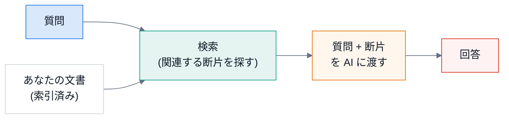

# 第 0 回 はじめに — RAG と MCP と、このサーバー

> 所要時間の目安: 1 時間 / 前提: なし

## この回のゴール

- **RAG**(検索で補強した生成)が、何を解決するか説明できる。
- **MCP**(Model Context Protocol)で、AI アプリが外の道具を呼ぶ仕組みが分かる。
- このサーバーの**全体の流れ**(索引を作る → 検索する)と、フォルダの地図を持てる。
- 手元で、検索の部品を呼んでみられる。

## 1. RAG とは

AI(大規模言語モデル)は、学習した知識しか持たず、**あなたのノート・社内文書・最新の資料**は知りません。
そこで、質問のたびに、**関連しそうな文書の断片を検索して、質問と一緒に AI に渡します**。これが **RAG**(Retrieval-Augmented Generation)です。



このサーバーが受け持つのは「**検索**」の部分です(回答は、MCP ホストの AI が書く)。

## 2. MCP とは

**MCP**(Model Context Protocol)は、AI アプリ(MCP ホスト。例: Claude Desktop)が、外のプログラム(MCP サーバー)の**道具(tool)**を呼ぶための共通の約束です。

- ホストがサーバーを**子プロセスとして起動**し、**標準入出力**(stdin / stdout)で、1 行 1 件の **JSON-RPC** を送り合う(第 5 回)。
- サーバーは「`search`(検索)」「`get_document_count`(件数)」という道具を**公開**する。AI は、必要なときに自分で呼ぶ。

## 3. このサーバーの全体


| 局面 | 流れ |
|---|---|
| **索引を作る**(事前) | 文書を読む → Markdown に変換 → チャンク(断片)に分ける → ベクトルにする → ChromaDB と BM25 に保存 |
| **検索する**(質問のたび) | クエリをベクトルにする → ベクトル検索と BM25 検索 → **RRF** で合わせる → 前後の断片も付けて返す |

講義の進み方: **チャンク(第 1 回)→ ベクトル(第 2 回)→ BM25 と日本語(第 3 回)→ 合わせる(第 4 回)→ MCP(第 5 回)→ 運用(第 6 回)→ テスト(第 7 回)**。

## 4. フォルダの地図

```text
mcp-rag-server/
├── src/
│   ├── main.py                 入口(UTF-8 の設定・サービスの組み立て)
│   ├── mcp_server.py           JSON-RPC over stdio
│   ├── rag_tools.py            公開する道具(search・get_document_count)
│   ├── rag_service.py          索引と検索の統括
│   ├── document_processor.py   読み込み・変換・チャンク分割・差分
│   ├── embedding_generator.py  ベクトル化(sentence-transformers)
│   ├── vector_database.py      ChromaDB + BM25 + RRF
│   └── cli.py                  索引の作成・クリア・件数
├── auto_index.py               Obsidian vault の自動インデックス(watchdog)
├── tests/
├── data/                       source/(原本)・processed/(変換済み)・chroma/(ベクトル)
└── docs/                       この文書
```

## 5. 部品を呼んでみる

重いモデルを読み込まずに、**検索の部品**(チャンク分割・日本語のトークン化)を呼びます。

```python
# 実行できる
from src.document_processor import DocumentProcessor
from src.vector_database import VectorDatabase

dp = DocumentProcessor()
text = "RAG は、検索で補強して回答を作る方法です。MCP は、AI が道具を呼ぶ約束です。\n" * 4
chunks = dp.split_into_chunks(text, chunk_size=60, overlap=10)
print("チャンクの数:", len(chunks))

vd = VectorDatabase({"chroma_path": "./data/chroma_doc_demo"})     # 接続しない(まだ何も作らない)
print("トークン:", vd._tokenize("Unity のシェーダーを学ぶ(BTQ-116)"))
```

```text
# 出力
チャンクの数: 4
トークン: ['unity', 'シェーダー', '学ぶ', 'btq', '116', 'btq-116']
```

トークンには、日本語の語(`シェーダー`・`学ぶ`)と、英数字の語(`unity`・`btq-116`)が、**両方**入ります(第 3 回)。

## 確認問題

1. RAG で、AI に渡すものは何ですか。
2. このサーバーは、RAG の「検索」「回答」のどちらを担当しますか。
3. MCP ホストとサーバーは、何を使って会話しますか。

## 解答

1. 質問と、検索で見つけた**関連する文書の断片**。
2. 「検索」。回答は、ホストの AI が書く。
3. 標準入出力(stdin / stdout)の、1 行 1 件の **JSON-RPC**。

## まとめ

- RAG は、質問のたびに関連する断片を検索して、AI に渡す方法。
- MCP は、AI アプリが外の道具を呼ぶ共通の約束(標準入出力の JSON-RPC)。
- このサーバーは、索引の作成と検索を担当する。検索は、ベクトル + BM25 を RRF で合わせる。
- 次の回は、文書を断片に分ける(チャンク分割)。
