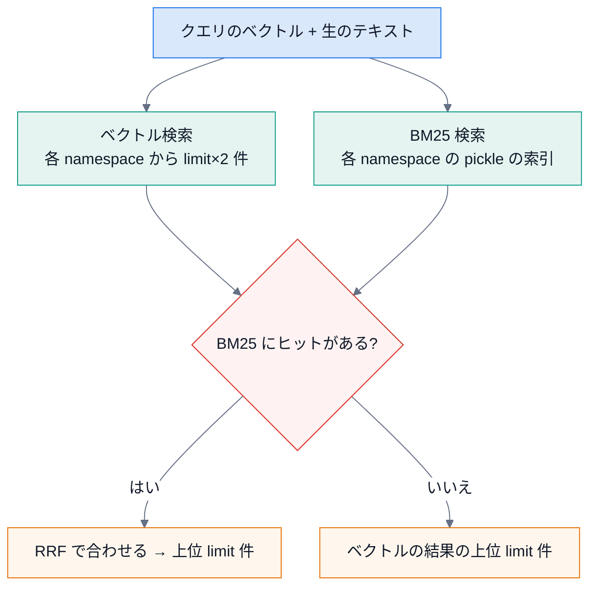

# 第 4 回 2 つの検索を合わせる(ハイブリッド検索と RRF)

> 所要時間の目安: 3 時間 / 前提: 第 3 回

## この回のゴール

- ベクトル検索と BM25 の**スコアを、そのまま足せない**理由を説明できる。
- **RRF**(Reciprocal Rank Fusion)の式と、「順位だけを使う」利点が分かる。
- `search` の流れ(取得 → 合わせる → 件数を切る)を読める。
- ハイブリッドで、**どちらか片方でしか見つからないもの**が拾える例を作れる。

## 1. 足せないスコア

| 検索 | スコアの意味 | 範囲 |
|---|---|---|
| ベクトル | コサイン類似度(`1 - 距離`) | 0〜1 |
| BM25 | 語の一致の点 | 0〜数十(クエリ・文書で変わる) |

単位も範囲も違うので、**そのまま足すと、BM25 の大きな数字が勝つ**だけになります。重みを手で決めても、質問ごとに最適が変わります。

## 2. RRF: 順位だけを使う

**Reciprocal Rank Fusion** は、スコアを捨てて、**順位だけ**を使います。

```text
RRF のスコア = 1 / (k + ベクトルでの順位) + 1 / (k + BM25 での順位)     (k = 60。Cormack ら 2009)
```

- どちらの検索でも**上位**に出た断片が、高い点になる。
- 片方にしか出なくても、**ある程度の点**は付く(拾える)。
- 順位だけなので、**スコアの単位・範囲が違っても合わせられる**。
- `k = 60` は、上位の差を、やや緩める定数(標準値)。

```python
# 引用: src/vector_database.py::VectorDatabase._rrf_merge
@staticmethod
def _rrf_merge(
    vector_results: list[dict],
    bm25_results: list[dict],
    limit: int,
    k: int = 60,
) -> list[dict]:
    """
    Reciprocal Rank Fusion でベクトル検索と BM25 の結果をマージ。

    RRF score = 1/(k + vector_rank) + 1/(k + bm25_rank)
    k=60 が標準値（Cormack et al. 2009）。
    """
    rrf_scores: dict[str, float] = {}
    doc_map: dict[str, dict]     = {}

    for rank, r in enumerate(vector_results):
        did = r["document_id"]
        rrf_scores[did] = rrf_scores.get(did, 0.0) + 1.0 / (k + rank + 1)
        doc_map[did] = r

    for rank, r in enumerate(bm25_results):
        did = r["document_id"]
        rrf_scores[did] = rrf_scores.get(did, 0.0) + 1.0 / (k + rank + 1)
        if did not in doc_map:
            doc_map[did] = r

    sorted_ids = sorted(rrf_scores, key=lambda d: rrf_scores[d], reverse=True)
    merged = []
    for did in sorted_ids[:limit]:
        r = dict(doc_map[did])
        r["similarity"] = rrf_scores[did]  # RRF スコアで上書き
        merged.append(r)
    return merged
```

```python
# 実行できる
from src.vector_database import VectorDatabase

mk = lambda i: {"document_id": i, "content": i, "file_path": "", "chunk_index": 0, "similarity": 0.0}
vector = [mk("A"), mk("B"), mk("C")]          # 意味検索の順位: A, B, C
bm25 = [mk("D"), mk("B"), mk("E")]            # 語の検索の順位: D, B, E(D は型番の一致)
merged = VectorDatabase._rrf_merge(vector, bm25, limit=5)
for r in merged:
    print(r["document_id"], round(r["similarity"], 5))
print("手計算 B:", round(1 / (60 + 2) + 1 / (60 + 2), 5), "/ A:", round(1 / (60 + 1), 5))
```

```text
# 出力
B 0.03226
A 0.01639
D 0.01639
C 0.01587
E 0.01587
手計算 B: 0.03226 / A: 0.01639
```

- **B は、どちらでも 2 位**なので、どちらでも 1 位の A・D より高い点で、**1 位**になる。
- **D(語でだけ見つかった型番)**・**C**・**E** も、結果に**残る**(片方でしか出ないものも拾える)。
- 同点(A と D)は、辞書への入れ方の順(ベクトル側が先)で並ぶ。

## 3. `search` の流れ

`VectorDatabase.search` は、次の順です(`query_text` がある場合)。



- RRF のために、最終の件数の **2 倍**を、それぞれから取る(`fetch_n = limit * 2`)。多めに取って、順位を安定させる。
- **namespace**(最初の階層のフォルダ)を指定しなければ、**全部のコレクションを横断**して検索する。
- BM25 に何もヒットしなければ(型番が一致しない質問など)、**ベクトルだけ**の結果にする。
- 結果の `similarity` は、RRF のあとは **RRF の点**で上書きされる(元のコサイン類似度ではない)。値は小さい(0.03 程度が最大)。

## 4. 前後の文脈を付ける

見つけた断片の**前後の断片**も取ると、文脈が通ります。`rag_service.search` が、`with_context=True` のとき、`get_adjacent_chunks` で前後 `context_size` 個を足し、**ファイルパスとチャンク番号の順**に並べ直します(重複は除く)。
`full_document=True` なら、見つけた断片のファイルの**全チャンク**を足します(長い文書では、AI に渡す量が増えるので注意)。

**既知の問題**: 足した断片には、`is_context`・`is_full_document` の印も、`similarity` も付きません(`get_adjacent_chunks`・`get_document_by_file_path` が付けない)。`rag_tools.search_handler` は、印を見て「前後のコンテキスト」「ドキュメント全文」と表示を変えるので、**足した断片も「検索ヒット(類似度 0.00%)」と表示されます**。内容は正しく含まれますが、どれが本当のヒットかが、見分けにくい([トラブルシュート](../learn/06-troubleshooting-maintenance.md))。

## 確認問題

1. ベクトルのスコアと BM25 のスコアを、そのまま足してはいけない理由は。
2. 上の例で、D が結果に残るのは、なぜですか。
3. `k` を大きくすると、上位と下位の点の差は、どうなりますか。
4. RRF のあとの `similarity` が、0.03 のような小さい値になるのは、なぜですか。

## 解答

1. 単位と範囲が違い、BM25 の大きな数字が勝つだけになるから。
2. RRF は、**片方の検索にしか出ない断片にも点を付ける**(BM25 の 1 位 = 1/61)から。
3. 小さくなる(`1/(k+順位)` の差が縮む)。順位の差が、あまり効かなくなる。
4. 1 つの検索の 1 位でも `1/61 ≈ 0.016`、2 つで 1 位でも約 `0.033` が上限だから。意味のある「類似度」ではなく、**並べ替えのための点**。

## まとめ

- ベクトル(意味)と BM25(語)は、得意が違う。合わせると、どちらかでしか見つからないものも拾える。
- RRF は順位だけを使うので、単位が違うスコアを合わせられる。
- 前後の文脈・全文は、`rag_service` が後から足す。
- 次の回は、これらを AI に渡す口 — MCP(JSON-RPC)。
