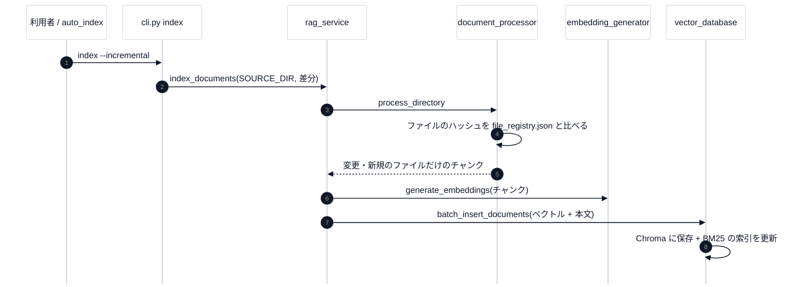

# 第 6 回 索引を作る運用(差分・namespace・自動インデックス)

> 所要時間の目安: 3 時間 / 前提: 第 4 回

## この回のゴール

- **差分インデックス**(変わったファイルだけを処理)の仕組み(ハッシュ・レジストリ)を説明できる。
- **namespace**(最初の階層のフォルダ = ChromaDB のコレクション)の決まりを説明できる。
- `auto_index.py` の**監視 → 待つ(デバウンス)→ 差分を実行**の流れを説明できる。
- 運用上の**落とし穴**(既知の食い違い)を知る。

## 1. 索引を作る流れ



- 原本(`SOURCE_DIR`)を、`markitdown` で **Markdown に変換**して `processed/` に保存し、それをチャンクに分ける(PDF・Word・PowerPoint も扱える)。
- 差分の判断は、ファイルの**ハッシュ・更新日時(mtime)・サイズ**を、`processed/file_registry.json` に記録したものと比べる。**どれか 1 つでも違えば**、再処理する(新規のファイルも対象)。処理したあと、レジストリを更新する。
- ハッシュは中身の指紋で、日時やサイズが同じでも、**中身が変われば**変わる。逆に、中身が同じでも**日時が変われば**(保存し直し・同期)、再処理される。

```python
# 実行できる
import hashlib
import tempfile
from pathlib import Path

from src.document_processor import DocumentProcessor

dp = DocumentProcessor()
with tempfile.TemporaryDirectory() as tmp:
    f = Path(tmp) / "note.md"
    f.write_text("最初の内容", encoding="utf-8")
    h1 = dp.calculate_file_hash(str(f))
    f.write_text("最初の内容", encoding="utf-8")            # 同じ内容で書き直す
    h2 = dp.calculate_file_hash(str(f))
    f.write_text("内容を変えた", encoding="utf-8")
    h3 = dp.calculate_file_hash(str(f))
print("同じ内容 → 同じハッシュ:", h1 == h2)
print("内容が変わると違うハッシュ:", h1 != h3)
print("ハッシュの長さ:", len(h1))
```

```text
# 出力
同じ内容 → 同じハッシュ: True
内容が変わると違うハッシュ: True
ハッシュの長さ: 64
```

## 2. namespace

`SOURCE_DIR` の**最初の階層のフォルダ名**が、ChromaDB の**コレクション名(namespace)**になります。

```python
# 引用: src/vector_database.py::VectorDatabase._namespace_from_path
def _namespace_from_path(self, file_path: str) -> Optional[str]:
    source_dir = os.environ.get("SOURCE_DIR", "")
    try:
        rel = Path(file_path).relative_to(source_dir)
        parts = rel.parts
    except ValueError:
        parts = Path(file_path).parts

    if len(parts) > 1:
        first = parts[0]
        if first.startswith(("_", ".")):
            return None
        return first
    return "default"
```

```python
# 実行できる
import os

from src.vector_database import VectorDatabase

os.environ["SOURCE_DIR"] = "vault"
vd = VectorDatabase({"chroma_path": "./data/chroma_doc_demo"})
for p in ["vault/tutorials/unity.md", "vault/chat_logs/2026/a.md", "vault/_templates/t.md", "vault/.obsidian/x.md", "vault/readme.md"]:
    print(f"{p:32s} → {vd._namespace_from_path(p)!r}")
```

```text
# 出力
vault/tutorials/unity.md         → 'tutorials'
vault/chat_logs/2026/a.md        → 'chat_logs'
vault/_templates/t.md            → None
vault/.obsidian/x.md             → None
vault/readme.md                  → 'default'
```

- `_` または `.` で始まるフォルダ(`_templates`・`.obsidian`)は、**索引の対象外**(`None`)。
- フォルダに入っていない(直下の)ファイルは `default`。
- 検索で namespace を指定すれば、そのコレクションだけを探す(指定しなければ全部)。

## 3. 自動インデックス(`auto_index.py`)

Obsidian の vault を、`watchdog` で**監視**します。Markdown が保存されたら、差分の索引を自動で実行します。

- **デバウンス**: 3 秒以内の連続した変更は、**1 回にまとめる**(保存のたびに重い処理を走らせない)。
- `.md` だけが対象。`_rag_dashboard`・`_templates`・`.obsidian`・`.processed` は無視。
- 実行は、`uv run python -m src.cli index --incremental` を**子プロセス**で呼ぶ。
- 起動時に、**期限(`expires`)の確認**をする: frontmatter の `expires` を過ぎていて `status: active` なら、ファイルを**書き換えて** `status: stale` にする。

```python
# 実行できる
import tempfile
from pathlib import Path

import auto_index

with tempfile.TemporaryDirectory() as tmp:
    note = Path(tmp) / "old.md"
    note.write_text("---\nstatus: active\nexpires: 2020-01-01\n---\n本文", encoding="utf-8")
    fm = auto_index.read_frontmatter(note)
    print("読み取り:", fm["status"], str(fm["expires"]))
    print("期限切れで書き換えた:", auto_index.check_expires(note, fm))
    print("ファイルの 2 行目:", note.read_text(encoding="utf-8").splitlines()[1])
```

```text
# 出力
読み取り: active 2020-01-01
  [期限切れ] old.md → status: stale
期限切れで書き換えた: True
ファイルの 2 行目: status: stale
```

**ファイルを書き換える**処理です(索引の外の、文書そのものが変わる)。意図した動作ですが、vault をバックアップしてから使う。

## 4. 既知の食い違い(運用の落とし穴)

| 内容 | どうなるか |
|---|---|
| `status: archived` | `auto_index.py` は「再インデックスを起動しない」だけ。**`src/` は frontmatter を読まない**ので、CLI の索引では、アーカイブ済みも対象のまま |
| `auto_index.py` の冒頭の設定 | vault と、このリポジトリの場所が、**特定の PC のパスに固定**されている。他の PC では、書き換えが要る |
| 古い設定の名残 | `rag_tools.py` の `create_rag_service_from_env` に、PostgreSQL 時代の環境変数(`POSTGRES_*`)の読み取りが残っている(ChromaDB 版では使わない) |
| `CLAUDE.md` | PostgreSQL / pgvector 版の説明のまま。現在は ChromaDB |

([メンテナンス](../learn/06-troubleshooting-maintenance.md) に、直し方の案がある)

## 確認問題

1. 差分の判断に、更新日時とサイズだけでなく、**ハッシュも**使う利点は。
2. `vault/_templates/t.md` は、どの namespace に入りますか。
3. デバウンスがないと、何が困りますか。
4. `status: archived` にしたノートが、検索結果に出てくることがあるのは、なぜですか。

## 解答

1. 日時とサイズが同じでも、**中身が変わった**ファイル(まれ)を、確実に検出できる。ただし、判断は「どれか 1 つでも違えば再処理」なので、**日時だけが変わった**(保存し直し・同期)場合も、再処理される(取りこぼしより、無駄な再処理を選んだ設計)。
2. どこにも入らない(`None`)。`_` で始まるフォルダは、対象外。
3. 保存のたびに、重い索引の処理が走る(Obsidian は、自動保存で、短時間に何度も書く)。
4. `src/` が frontmatter の `status` を読まず、CLI の索引は、フォルダの全ファイルを対象にするから。`auto_index.py` が避けるのは、再インデックスの**起動**だけ。

## まとめ

- 差分は、ファイルのハッシュ・更新日時・サイズを、レジストリと比べて判断する(どれか 1 つでも違えば再処理)。原本は Markdown に変換してから、チャンクにする。
- namespace は、最初の階層のフォルダ名。`_`・`.` で始まるものは対象外。
- 自動インデックスは、監視 + デバウンス + 差分の CLI。`expires` はファイルを書き換える。
- 運用の落とし穴(archived・固定パス・古い設定・CLAUDE.md)を知っておく。
- 次の回は、テストと総合演習。
